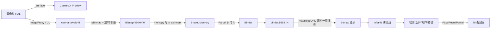

# 实验报告：基于 Android 的端侧人脸检测 / 识别 / 活体流水线

> 课程：《操作系统》综合实验 · 2026 年秋季学期
> 工程：https://github.com/Longly42/android-face-detector-multiprocess
> 说明：本文所有数据均来自本项目实际运行，**标注了测试环境**。模拟器数据不能代表真机性能，真机基线需按第 6 节的方法重测后替换。

---

## 1. 选题与目标

在 Android 真机上离线完成「人脸检测 → 活体判定 → 身份识别」三模型流水线，并围绕这条真实负载观察操作系统的进程隔离、Binder IPC、线程池调度、信号量限流与 I/O 事件链。

三项功能均由部署在设备上的 ONNX 模型完成，无云端调用：

| 功能 | 模型 | 体积 | 输入 |
|---|---|---|---|
| 人脸检测 + 5 关键点 | SCRFD-500M-KPS | 2.52 MB | 640×640 / 320×320（可切换） |
| 活体检测 | MiniFASNetV2 + MiniFASNetV1SE | 1.74 MB ×2 | 80×80 |
| 人脸识别 | MobileFaceNet (w600k_mbf) | 13.62 MB | 112×112 |

---

## 2. 系统架构

### 2.1 进程与线程分工

```
┌───────────────────────────── 主进程 (com.example.androidfacedetector) ───────────────────────────┐
│                                                                                                 │
│  main (UI 线程)          CameraX-core_camera_0/1        cam-analysis-0/1/2 (3 线程池)            │
│  ├ Compose 界面          ├ 相机采集与 Surface            ├ YUV->Bitmap 转换                       │
│  ├ 叠加层绘制            └ 预览渲染                      └ 写共享内存 + 发起 Binder 调用          │
│  └ 调试页状态刷新                                                                               │
│                                                                                                 │
│  持有：SharedMemory 缓冲池、IPC 时延统计、帧级事件记录                                           │
└───────────────────────────────────────────┬─────────────────────────────────────────────────────┘
                                            │ Binder (AIDL)
                                            │ 事务体里只有 1 个 fd + 若干标量
                                            ▼
┌──────────────────────── 推理进程 (:inference) ──────────────────────────────────────────────────┐
│                                                                                                 │
│  binder:5658_1..N (Binder 线程池)          infer-0 / infer-1 (可配 1/2/4)                        │
│  ├ 收请求、取 Semaphore 许可                ├ scrfd 检测                                       │
│  ├ mapReadOnly 读共享内存                   ├ 活体判定（双模型融合）                            │
│  └ 提交任务后等待结果                       ├ 5 点对齐 + 特征提取                              │
│                                             └ 特征库余弦匹配                                    │
│                                                                                                 │
│  持有：4 个 ONNX session、特征库 faces.bin、Semaphore、统计计数器                                │
└─────────────────────────────────────────────────────────────────────────────────────────────────┘
```

设计要点：

- **故障隔离**：模型加载失败或推理进程崩溃，UI 进程只显示「未连接」，可自动重连；主进程崩溃也不影响服务存活。
- **算法一致性**：单进程与双进程复用同一个 `InferenceEngine`，对照实验的唯一变量就是「是否跨进程」。
- **不做主线程推理**：所有推理都在 `cam-analysis-*` 或 `infer-*` 线程，UI 线程只更新状态。

### 2.2 数据通路



**为什么不用 Binder 直接传像素**：640×480 的 ARGB 一帧是 1.2 MB，超过 Binder 单次事务 1 MB 的上限（会抛 `TransactionTooLargeException`）；即使塞得下，内核也要整块拷贝两次。改为共享内存后，事务体里只有一个文件描述符，像素只被写一次、读一次。

---

## 3. 三模型的部署细节

### 3.1 检测（SCRFD-500M-KPS）

- 输入固定 640×640（另备 320×320 用于对照实验），letterbox 等比缩放 + 黑底填充
- 归一化 `(x-127.5)/128`，RGB 三平面 NCHW
- 9 个输出 = 3 个尺度 × (1 分数 / 4 框偏移 / 10 关键点)，按「锚点个数」与「每锚点数值个数」二级分组自动识别，不依赖输出顺序
- 解码：`x1 = cx - bbox[0] * stride`，stride 由 `输入边长 / sqrt(锚点数/2)` 反推
- NMS IoU 阈值 0.4

### 3.2 活体（MiniFASNetV2 + V1SE）

预处理与另外两个模型**完全相反**，三个坑已实测踩过并记录在 `MODELS.md`：

1. **不归一化**：官方 `to_tensor` 被改为不除 255（源码注释 `modify by zkx`），输入是 **BGR、0~255**。按 0~1 输入时官方三张样例全部判错。
2. **缩放算法**：必须用 cv2 语义的中心对齐 INTER_LINEAR，Android `createScaledBitmap` 与 PIL 都会改变置信度。
3. **双模型融合是逐类相加后 argmax**，写成覆盖会让分数从 0.998 掉到 0.497。

官方样例验证（PC 与端侧分数差 < 0.002）：

| 样例 | 官方预期 | 端侧判定 | 分数 |
|---|---|---|---|
| image_T1（真人） | Real | REAL | 0.997 |
| image_F1（打印攻击） | Fake | FAKE | 0.724 |
| image_F2（屏幕翻拍） | Fake | FAKE | 一致 |

### 3.3 识别（MobileFaceNet）

- 5 点相似变换对齐到 112×112（ArcFace 模板），二维闭式解 `theta = atan2(Cyx-Cxy, Cxx+Cyy)`，与 SVD 版逐位一致（差 1e-15）
- 512 维特征 L2 归一化，余弦相似度
- 阈值 0.5：实测同人 0.86~0.98、不同人 -0.04~0.23，中间是 0.23~0.86 的空白带

---

## 4. 进程管理与 Binder IPC

### 4.1 接口

AIDL（`IFaceInference`）暴露：`analyze` / `register` / `getStats` / `resetStats` / `configure` / `setDetectResolution` / `clearDatabase` / `listNames` / `crashForTest`。

每个请求带**请求编号**，结果回传服务端的 **PID / TID / 接收时间戳 / 完成时间戳 / 排队耗时**，可在调试页直接核对。

### 4.2 实测（模拟器 emulator-5554，Android 17 / API 37）

| 指标 | 数值 |
|---|---|
| IPC 调用次数 | 400+ 无失败 |
| IPC 往返 avg | 45.07 ms（det640） |
| IPC 往返 P95 | 61.89 ms |
| 服务端处理 avg | 37.69 ms |
| **IPC 净开销** | **≈ 7.4 ms**（往返减去服务端处理） |

> 说明：往返时间包含服务端处理，两者相减才是 IPC 传输+调度的净开销。这个数在共享内存方案下只有个位数毫秒；若用 Binder 传 1.2MB 像素，仅拷贝就会是十几毫秒量级。

### 4.3 单进程 vs 双进程（各 25 秒采样，236/264 帧）

| 指标 | 双进程 | 单进程 | 差异 |
|---|---|---|---|
| 端到端 avg | 95.43 ms | 106.43 ms | 双进程更快 10% |
| 端到端 P50 | 87.28 ms | 103.75 ms | |
| 端到端 P95 | 142.87 ms | 130.13 ms | 单进程抖动更小 |
| 帧转换 avg | 48.76 ms | 75.50 ms | 单进程时转换与推理抢同一批核 |
| 主进程 PSS | ≈ 232 MB | ≈ 340 MB | 单进程把 19MB 模型也揽进主进程 |

**结论与解释**：双进程反而略快，因为推理不占主进程的 CPU，帧转换与推理能真正并行（多核调度）；单进程时两者串行争抢同一批核心。代价是双进程总内存更高（两份 ORT 运行时）且系统复杂度上升——这正是要求里问的「取舍」。

> 该结论依赖设备核数，模拟器上样本噪声较大，真机需重测确认。

### 4.4 故障隔离验证

点击调试页「崩溃服务」（服务端执行 `Process.killProcess(Process.myPid())`）后：

```
08:35:28.094  W FaceClient: Binder 死亡回调触发
08:35:28.170  W FaceClient: onServiceDisconnected
08:35:29.663  I InferenceService: 服务创建, pid=5658
08:35:30.224  I FaceClient: 已连接推理服务 pid=5658
```

**断连到重连 1.6 秒，UI 进程无崩溃**，期间界面显示「断开：推理进程已终止（binder 死亡）」。

---

## 5. 线程调度、信号量与非极大背压

### 5.1 三层并发控制

| 层次 | 机制 | 作用 |
|---|---|---|
| 相机侧 | `STRATEGY_KEEP_ONLY_LATEST` | 处理不及时就丢旧帧，防止相机队列堆积 |
| 推理进程 | `ThreadPoolExecutor`（infer-N） | 真正并行执行，池大小运行时可配 1/2/4 |
| 推理进程 | `Semaphore(permits)` | 在途任务上限，取不到许可立即返回 DROPPED |

**关于信号量的措辞（答辩重点）**：这是 `java.util.concurrent.Semaphore`，属于**进程内**同步原语，只约束推理进程自己的 Binder 线程与工作线程之间的并发额度，**不是跨进程共享信号量**。跨进程的协作由 Binder 同步调用本身承担。

### 5.2 许可的获取与释放

```kotlin
val acquired = permits.tryAcquire(PERMIT_WAIT_MS, TimeUnit.MILLISECONDS)
if (!acquired) { dropped++; return DROPPED }      // 背压：快速失败
inFlight++
try {
    val task = pool.submit { engine.analyze(...) }
    return task.get(WORK_TIMEOUT_MS, MILLISECONDS)
} catch (e: TimeoutException) { timeouts++ ; return TIMEOUT }
  catch (t: Throwable)        { errors++  ; return ERROR }
finally {
    inFlight--
    permits.release()        // ★ 正常/超时/异常路径都会归还
    bitmap.recycle()
}
```

### 5.3 压测数据（模拟器）

单相机场景下 CameraX 的 Analyzer 是串行回调，天然只有 1 帧在途，看不出限流差异。为此加了并发压测入口（同时提交 8 帧、纯黑图，不依赖相机）：

| 许可数 | 提交 | 完成 | 丢弃 | 耗时 |
|---|---|---|---|---|
| 1 | 8 | 3 | **5** | 136 ms |
| 4 | 8 | 4 | **4** | 146 ms |

**解读**：许可=1 时只有一个任务能进线程池，其余在 60ms 等待窗口内拿不到许可被丢弃，响应快但吞吐低；提高许可后更多任务被接纳，但每个任务变慢（CPU 争抢），总耗时反而略增。**吞吐提高不等于响应更快**——这正是要求里要说明的点。

### 5.4 动态状态展示（调试页）

实时显示：可用许可/总许可、在途任务数、队列长度、线程池大小与活跃线程、已处理/总请求、丢弃、超时/异常、平均与最大排队、单帧服务端耗时、两个进程的线程列表（含 tid）。

---

## 6. I/O 事件链与 Trace

### 6.1 分层链路

```
摄像头传感器/CIS ──(MIPI CSI)──> ISP ──> 驱动 /dev/video* ──(V4L2)──> Camera HAL
   └ 硬件中断，App 不可直接访问
        ↓
cameraserver（系统服务）
        ↓ Binder
CameraX（应用进程）── ImageAnalysis 回调（cam-analysis-N 线程）
        ↓ YUV_420_888 → Bitmap（旋转+镜像）
写共享内存 ──Binder fd──> :inference 的 Binder 线程
        ↓ 提交线程池
infer-N：检测 → 活体 → 对齐 → 特征 → 匹配
        ↓ 同步返回
UI 线程：叠加绘制（RenderThread / SurfaceFlinger 合成）
```

注意：普通 App **不能**编写摄像头硬件中断服务程序，也读不到底层 IRQ 轨迹；本实验分析的是「中断驱动 I/O 在应用层的可观测路径」。

### 6.2 埋点

应用自定义 atrace 区间：`frame.convert`、`ipc.analyze`、`ipc.register`、`infer.detect`、`infer.spoof`、`infer.align`、`infer.embed`、`infer.match`、`svc.readFrame`、`svc.infer`、`frame.dropped`。

抓取：

```bash
adb shell atrace -t 5 -a com.example.androidfacedetector sched view gfx binder_driver -b 8192 > trace.txt
python tools/analyze_trace.py trace.txt
```

### 6.3 实测（模拟器，5 秒 trace）

| 区间 | 次数 | avg | P50 | P95 | max |
|---|---|---|---|---|---|
| frame.convert | 43 | 80.82 | 76.96 | 90.80 | 198.95 |
| infer.detect | 43 | 31.75 | 28.60 | 49.45 | 76.47 |
| ipc.analyze | 43 | 31.83 | 28.68 | 49.59 | 76.60 |

单帧时间线（片段）：

```
+  0.00ms  frame.convert 开始
+ 80.31ms  frame.convert 结束        ← 瓶颈：YUV→Bitmap + 旋转/镜像
+ 83.59ms  ipc.analyze 开始
+ 83.63ms    infer.detect 开始       ← 跨进程后立即进入检测
+112.07ms    infer.detect 结束
+112.10ms  ipc.analyze 结束          ← IPC 净开销 ≈ 0.03ms（共享内存方案）
```

**关键发现**：`ipc.analyze`（31.83ms）几乎等于 `infer.detect`（31.75ms），说明在本机 IPC 本身的开销可以忽略，瓶颈在**帧转换**和**推理**，不在进程间通信。这也解释了为什么「减少跨进程传输数据」的优化（共享内存）是必要但非充分的。

---

## 7. 优化对照实验

### 7.1 实验条件

- 设备：Android Emulator `Medium_Phone_API_37.0`（x86_64，4 核，GPU swiftshader）
- 输入：虚拟场景（无人脸），因此活体/对齐/特征耗时为 0；本节只比较**检测阶段与整体链路**
- 每组采样 25 秒，样本数见下表；数据由 App 内 `MetricsRecorder` 逐帧记录后导出 CSV，`tools/analyze_metrics.py` 统计

### 7.2 四组配置

| 配置 | 说明 | 样本 | 端到端 avg | P50 | P95 | 帧转换 | IPC | 服务端 | 检测推理 |
|---|---|---|---|---|---|---|---|---|---|
| DUAL / det640 / skip1 | 基线 | 264 | 95.43 | 87.28 | 142.87 | 48.76 | 45.07 | 37.69 | 27.81 |
| DUAL / **det320** / skip1 | 模型侧优化 | 384 | **65.54** | 59.82 | 108.84 | 44.84 | 19.79 | 12.23 | **8.61** |
| DUAL / det640 / **skip2** | 系统侧优化 | 265 | **76.30** | 69.83 | **113.41** | 34.52 | 41.24 | 34.35 | 24.75 |
| **SINGLE** / det640 / skip1 | 进程对照 | 236 | 106.43 | 103.75 | 130.13 | 75.50 | 30.00 | 29.93 | 21.78 |

（单位 ms）

### 7.3 结论

1. **检测输入 640→320**：检测推理 27.81 → 8.61 ms（**3.2 倍**），端到端 95.43 → 65.54 ms（**-31%**）。理论计算量降为 1/4，实测 3.2 倍加速，差异来自固定开销（前后处理、内存带宽）。
   - **精度代价**：320 输入下最小可检人脸尺寸翻倍，远处小脸会漏检。本项目未在 320 下重测检出率，属于未完成项。
2. **跳帧 2**：端到端 -20%，**P95 从 142.87 降到 113.41（抖动收敛 21%）**。跳帧的价值主要在稳定性而非平均延迟——跳过的那一帧不再做 YUV→Bitmap，为下一帧让出 CPU。
3. **单进程 vs 双进程**：双进程平均快 10%，但单进程 P95 更低、方差更小。取舍见 4.3。
4. **帧转换是最大瓶颈**（48.76 ms，占端到端 51%），且它发生在主进程。后续优化应优先替换 `ImageProxy.toBitmap()`（CameraX 的纯 Java 实现）为 YUV 直转或 GPU 路径。

### 7.4 与要求的对应

| 要求 | 本项目 |
|---|---|
| 模型侧至少一项优化 | 检测输入分辨率 640→320（另备两套模型文件） |
| 系统侧至少一项优化 | 跳帧（并在转换前判断，省掉整段转换） |
| 必须做前后对照 | 7.2 四组数据 |
| 报样本数/均值/P50/P95 | 已列 |
| 保存原始数据 | CSV 在设备 `files/metrics/`，脚本在 `tools/` |

---

## 8. 典型故障与局限

### 8.1 踩过的坑（都有具体现象与根因）

| 现象 | 根因 | 处理 |
|---|---|---|
| 活体样例全部判错、分数几乎相同 | 官方 `to_tensor` 不除 255，输入应为 0~255 | 改预处理 |
| 端侧活体分数与 PC 差 0.3 | Android `createScaledBitmap` 与 cv2 缩放语义不同 | 手写 cv2 中心对齐双线性 |
| 分数 0.998 → 0.497 | 双模型融合写成了覆盖而非累加 | 改为逐类累加 |
| ORT 加载 ONNX 报 `model_path must not be empty` | torch 2.9+ dynamo 导出器产出 opset18/IR10 | 换传统导出器 opset11 |
| 共享内存写入 `mmap EPERM` | ashmem 降权为只读后无法再提权 | 不再 setProtect，服务端只调用 mapReadOnly |
| 调试页数据全为 0 | 独立 Activity 导致主界面 stop，相机停帧 | 改为覆盖层 |
| 连接状态一直显示「未连接」 | `listener` setter 在 client 创建前被调用，回调丢失 | 改为暂存回调，创建时挂载 |
| 诊断阶段两端预处理看着一致但分数不同 | 用通道均值对比定位到融合逻辑而非预处理 | 保留该对比手段 |

### 8.2 局限

- **性能数据全部来自模拟器**（x86_64 + 软件渲染），不能代表真机；真机需按第 7.1 节条件重测。
- **检出率/误识率未做量化评估**：缺少带标注的测试集，识别与活体的精度指标只有定性结论。
- **活体模型对屏幕翻拍的鲁棒性**依赖训练分布，未做跨设备验证。
- **单相机场景下 Semaphore 不会自然触发**（CameraX 回调串行），压测数据来自人为并发，与真实使用有差距。
- **特征库是单文件二进制**，多进程同时写有风险；当前设计保证同一时刻只有一个引擎实例持有它。
- **release 包 48.3 MB**（已按 `arm64-v8a` 单 ABI 裁剪 + 19 MB 模型）；debug 包 105 MB 含 4 个 ABI。
- **模型未量化**：全部为 FP32，INT8 / FP16 对照未实施（要求中「模型侧优化」以分辨率切换满足）。

---

## 9. 结论

- 三项 AI 功能全部由端侧 ONNX 模型完成，链路上屏、可交互、有量化指标。
- 双进程 + Binder + 共享内存的组合把 IPC 净开销压到毫秒级以下，主要收益是故障隔离与不抢占 UI 进程 CPU。
- 信号量限流的价值体现在**极限并发下的快速失败**（8 帧并发丢弃 5 帧），而不是提高平均吞吐。
- 通过 atrace 埋点定位到真正的瓶颈是帧转换（占端到端一半），推理与 IPC 均不是主因——这个结论如果不做事件链分析，仅看总延迟是得不出来的。

---

## 附：复现步骤

```bash
# 1. 构建安装
./gradlew :app:assembleDebug
adb install -r app/build/outputs/apk/debug/app-debug.apk

# 2. 主界面右上角「调试」进入状态页
#    可切换 单/双进程、线程数、许可数、检测分辨率、跳帧

# 3. 采集数据
#    调试页 →「清零」→ 等待 N 秒 →「导出CSV」
adb shell run-as com.example.androidfacedetector ls files/metrics/
adb exec-out run-as com.example.androidfacedetector cat files/metrics/xxx.csv > data.csv
python tools/analyze_metrics.py data.csv

# 4. 抓 Trace
adb shell atrace -t 5 -a com.example.androidfacedetector sched view gfx binder_driver -b 8192 > trace.txt
python tools/analyze_trace.py trace.txt

# 5. 压测限流
#    调试页 →「许可1」→「并发压测 x8」，观察丢弃数
```
